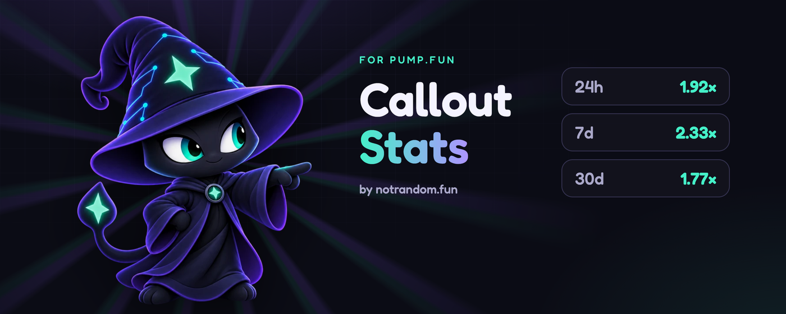
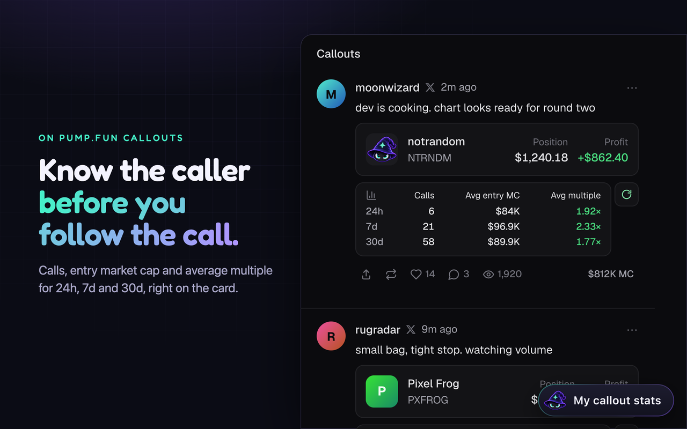
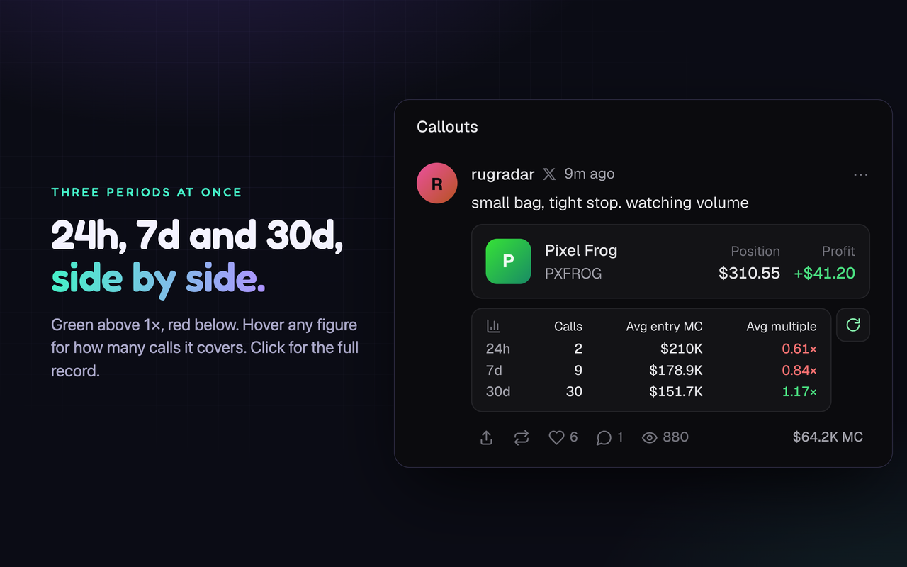
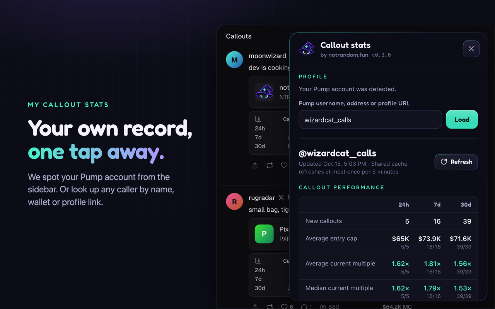
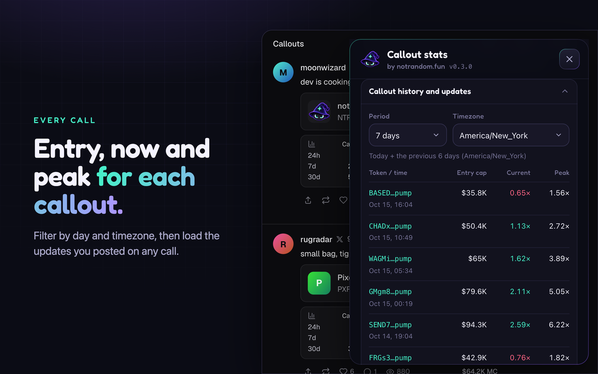
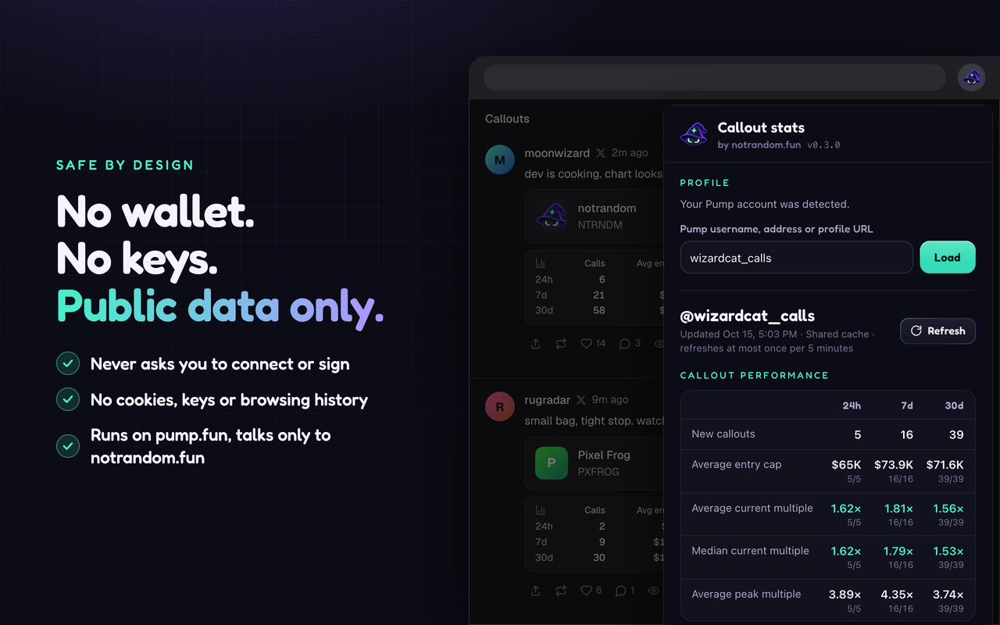

<p align="center">
  <a href="https://notrandom.fun/pump-fun-callout-stats/">
    
  </a>
</p>

<h1 align="center">Callout Stats for pump.fun</h1>

<p align="center"><strong>See the caller’s record. Right on the callout.</strong></p>
<p align="center">24h, 7d and 30d stats on pump.fun’s callout cards, with your own record one click away.</p>

<p align="center">
  <a href="https://github.com/MarkUnthank/pump-fun-callout-stats/releases/latest"></a>
  <a href="https://github.com/MarkUnthank/pump-fun-callout-stats/actions/workflows/checks.yml"></a>
  <a href="#install"></a>
  <a href="manifest.json"></a>
  <a href="LICENSE"></a>
</p>

<p align="center">
  <a href="https://github.com/MarkUnthank/pump-fun-callout-stats/releases/latest/download/callout-stats.zip"></a>
  <br>
  <a href="https://notrandom.fun/pump-fun-callout-stats/">Website</a> ·
  <a href="https://notrandom.fun/pump-fun-callout-stats/#privacy">Privacy</a> ·
  <a href="https://github.com/MarkUnthank/pump-fun-callout-stats/issues">Report a bug</a>
</p>

> [!IMPORTANT]
> **Chrome Web Store review is pending.** We’re waiting for Google’s review before the extension is listed. You can use the downloadable extension now with Chrome’s Developer mode. The normal **Add to Chrome** install will be available once the listing is approved.

## What you get

- **Caller stats on the cards.** Calls, average entry market cap and average multiple for **24h / 7d / 30d**, side by side.
- **Your own record.** Open **My callout stats** to see your performance, history, current and peak multiples, and median figures.
- **Look up any caller.** Use a pump.fun username, public wallet address or profile link. Loading a caller fills their other matching cards too.
- **History that makes sense.** Filter by Today, Yesterday, 7 days or 30 days, with your chosen timezone. Callout updates are listed separately.
- **Saved results, explicit refresh.** Previously loaded stats appear immediately. Use the reload icon to check for newer data; old results are marked.

**No wallet connection. No signature. No API key. No account to create with us.**



## Install

**No build tools or terminal needed.**

1. **[Download the extension ZIP](https://github.com/MarkUnthank/pump-fun-callout-stats/releases/latest/download/callout-stats.zip)** and unzip it. Keep the extracted folder somewhere permanent.
2. In desktop Chrome, type **`chrome://extensions`** into the address bar and turn on **Developer mode**.
3. Click **Load unpacked** and select the extracted folder containing **`manifest.json`**. Select the folder, not the ZIP.
4. Open or refresh **[pump.fun](https://pump.fun/)**. That’s it.

Chrome requires these manual steps for an unpacked extension. See [Google’s installation guide](https://developer.chrome.com/docs/extensions/get-started/tutorial/hello-world#load-unpacked) if you need a hand. Chrome on phones does not support this desktop extension.

### First lookup

Find **Caller stats** on a callout card and click **Load**. You’ll see all three time windows together. Click the loaded stats to inspect that caller, or use the reload icon to check again.

For your own stats, click **My callout stats** in the corner of pump.fun, or pin the extension and open it from Chrome’s toolbar. It detects your account from pump.fun’s sidebar when available. You can also enter your username or profile link manually and click **Load**. You do not need to buy anything to look up public stats.

### Update or remove

Download the latest ZIP, replace the files in your existing extension folder, then click **Reload** on its card at `chrome://extensions` and refresh pump.fun. Developer-mode installs do not update automatically.

To remove it, click **Remove** at `chrome://extensions`. This also clears its local extension storage.

## Take a look

<table>
  <tr>
    <td width="50%"><strong>A caller’s record, on their callout</strong><br></td>
    <td width="50%"><strong>Your stats, all three windows together</strong><br></td>
  </tr>
  <tr>
    <td><strong>Call history and updates</strong><br></td>
    <td><strong>No wallet connection required</strong><br></td>
  </tr>
</table>

These are the bundled Chrome Web Store screenshots, using illustrative callers and figures. The [store artwork](assets/) and [extension icons](icons/) are included in this repository.

## Understand the numbers

| Figure | What it means |
| --- | --- |
| **Calls** | Unique spot-token callouts in that window. Repeated calls on the same coin can count separately; updates to a call do not add a new call. |
| **Avg entry MC** | The average **USD market cap at the callout**, not the average token price. |
| **Avg multiple** | The arithmetic mean of the current multiples reported for those calls. Every measured call has equal weight, including losses and zero. |
| **Peak multiple** | Pump’s reported maximum multiple, shown separately in history. |

The performance tables use rolling **24, 168 and 720-hour** windows, calculated from the same snapshot. History filters use calendar days in your selected timezone. Missing data is excluded from the relevant average; the panel shows how many quotes each figure covers. A **+** after a count means the retrieved history is incomplete.

Multiples are snapshots of price moves, **not realized profit**. These stats do not reproduce pump.fun’s reward algorithm or explain eligibility for payouts. Separating updates from original callouts is this extension’s display methodology, not a claim about pump.fun’s payment rules.

## Privacy & permissions

The extension runs on **pump.fun** and uses **notrandom.fun’s hosted service** for public stats. No server setup is needed. This repository contains the extension frontend only.

| Permission | Why it’s needed |
| --- | --- |
| `storage` | Save your chosen profile, period, timezone and recent public snapshots on your device. |
| `https://pump.fun/*` content script | Add the caller stats and panel, and detect your account from the sidebar locally. |
| `https://notrandom.fun/*` host access | Request public caller stats from the hosted service. Chrome grants host access by origin. |

It does not request wallet access, signatures, cookies or browsing-history permissions. Public profile and callout identifiers are sent to the hosted service; saved public stats can be reused by other extension users. Your preferences stay local. The service also receives ordinary network metadata and applies request limits. Read the [privacy policy](https://notrandom.fun/pump-fun-callout-stats/#privacy) for handling and retention details.

The hosted service is shared and rate-limited. Refresh may return an existing snapshot instead of new data. If it asks you to wait, keep the saved result and try later.

## Troubleshooting

| What you see | What to do |
| --- | --- |
| No stats rows | Confirm the extension is enabled, then refresh pump.fun. If Pump changed its layout, use the toolbar lookup and [report the page](https://github.com/MarkUnthank/pump-fun-callout-stats/issues). |
| Your account isn’t detected | Enter your public username, wallet address or profile link manually. Account detection needs Pump’s sidebar identity link. |
| A caller has a **Load** button | Their stats are not available locally yet. Click it for an explicit lookup. |
| A clock, old timestamp or refresh warning | You’re seeing saved data. Use reload to check again; freshness and rate limits still apply. |
| No calls or incomplete history | Check the profile and time window. Only supported calls returned by the public data source can be counted. |

## For contributors

You can load the repository folder directly with **Load unpacked**. For tests and a distributable ZIP, use **Node.js 24+**:

```sh
npm ci
npm test
npm run package
```

The package is written to `dist/callout-stats.zip`, with an unpacked copy at `dist/callout-stats/`. Runtime scripts, styles, icons, mascot and the bundled font are included. Tests, screenshots and development dependencies stay outside the install ZIP. There are no runtime npm dependencies.

Please [open an issue](https://github.com/MarkUnthank/pump-fun-callout-stats/issues) with reproduction steps before a large change. Never post credentials, private keys or private account data. For security issues, use [private vulnerability reporting](https://github.com/MarkUnthank/pump-fun-callout-stats/security/advisories/new).

## Made by notrandom.fun

<a href="https://notrandom.fun"></a>

Built and maintained by **[notrandom.fun](https://notrandom.fun)**. Source code is available under the [MIT license](LICENSE). Fredoka is included under the [SIL Open Font License](fonts/LICENSE-fredoka.txt).

This is an independent extension. It is **not affiliated with, endorsed by or an official product of pump.fun or Google**.
